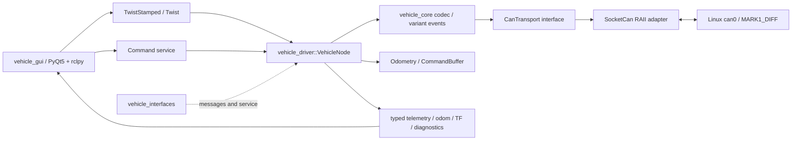

# 架构与工程取舍

ROS 节点关系、全部应用话题 / 服务、QoS 和数据字段见 [ROS 2 工程架构、通讯接口与数据结构](ros2-interfaces.md)。本文保留包边界、并发模型和工程取舍的设计依据。

## 包边界



- `vehicle_core`：不包含 ROS 头文件。协议编码/解码为纯函数；`std::variant` 表达不同反馈，避免共享万能数组及隐式有效位。`CanTransport` 是传输端口，`SocketCan` 是 Linux 适配器，文件描述符 RAII 管理；以后可替换为回放或其他测试实现。
- `vehicle_interfaces`：只放消息与服务，不依赖驱动实现；上层应用无需依赖 SocketCAN。
- `vehicle_driver`：ROS 适配与设备会话的组合入口。显式拥有配置、命令缓存、SocketCAN、里程计和待应答事务；没有 singleton、跨节点共享可变静态变量或 ROS 1/2 条件编译。
- `vehicle_gui`：独立 Python 展示层，View/ViewModel 与 rclpy 适配器分离；主线程处理 Qt，工作线程处理 DDS，不打开 CAN。遥测通过有界线程安全快照传递，运动输入必须持续续期。细节见[GUI 使用与设计](gui.md)，各功能的 CAN 发送顺序、频率与反馈映射见 [GUI 与 CAN 对照](gui-can.md)。

没有强行引入 `ros2_control` 的轮速控制器：当前固件已经提供整车 vx/wz 控制，轮径、减速比、有效轮距均未独立校准。增加轮级 hardware interface 会引入未经验证的单位和重复控制环。后续若确认轮级协议，可在稳定的传输端口旁扩展，不需要修改现有整车协议。

节点可独立运行，也通过 `rclcpp_components` 注册为组件。没有为本单设备驱动增加强制 lifecycle 转换流程；自动初始化一次即可工作，显式服务可接管启动意图。这是控制接口的取舍，不意味着缺少启动、失联与退出路径。

## 并发与时序

所有 ROS 回调都处于同一个默认 mutually-exclusive callback group。即使加载到多线程组件容器，设备会话也只有一个回调同时访问，无跨线程数据竞争。

- 每 2 ms 非阻塞读取 SocketCAN，每次最多处理 256 帧，给 DDS 及速度定时器保留执行机会。
- 每 20 ms 获取最新命令并发送；只缓存一个最新命令，不堆积运动队列。
- 服务通过 Jazzy deferred-response API 保存请求头，在后续 CAN 事件或超时后发出响应。没有 `sleep`、条件变量等待、忙等待，也没有服务回调自旋。
- 看门狗、服务超时、反馈新鲜度、里程积分时间间隔全部使用 `steady_clock`。ROS 时钟仅用于消息/TF 时间戳和上游 stamped command 的年龄检查。
- 接收时间戳是在用户态取出帧时记录，**不是设备时间戳或硬件同步时间**。当前 2 ms 轮询使延迟通常较小，但该设计不是硬实时系统。

## 初始化与控制权

首次看到配置身份的 B0，发送版本查询；若失能，发送一次使能并等待 B0。收到使能心跳后，一次发送模式 2 及四种反馈开关。使能等待超过 `service_timeout` 时给出提示，不无限重试。初始化不清零计数器。

显式服务操作取消尚未完成的自动初始化。运行中不会自动重新使能，也不抢回 CAN 模式。改变模式、失能、清计数器、复位会清空当前速度缓存并发零速；非数值或过时速度会清空旧命令。心跳过期也停止缓存命令。输入恢复需要新的有效命令。

配置参数只读，避免“ROS 参数改了、内部缓存未同步”的假成功。改配置通过重启完成；频繁设备操作通过类型化服务完成。

## CAN 资源与故障处理

正常帧的内核过滤器为：

```cpp
can_id   = address.base() | CAN_EFF_FLAG;
can_mask = 0x1FFFFF00 | CAN_EFF_FLAG | CAN_RTR_FLAG;
```

仅接收指定整车 class=01/type/node 的扩展数据帧；解码层再检查身份、长度、类型。错误帧单独通过 `CAN_RAW_ERR_FILTER` 订阅。普通过滤器的 mask 不包含 `CAN_ERR_FLAG`：Linux 会将含此位的过滤器归入错误帧接收链。这个差异已由真实 vcan 集成测试覆盖。

socket 采用 `SOCK_NONBLOCK | SOCK_CLOEXEC`，零初始化 CAN 数据，监听接收丢帧计数；不启用 CAN FD。`write` 成功只表示内核接收，协议响应另行处理。发送错误不重排旧运动帧、不无界重试。

I/O 错误或 bus-off 会丢弃旧命令、重建里程基线并关闭 socket；每秒尝试重新打开。节点不执行网卡 down/up、不清系统发送队列、不修改位率。若总线仍处于 bus-off，需宿主机恢复；仅重开 socket 不等于控制器恢复。vcan down/up 测试验证恢复后能重新接收，并且不重放故障前速度。

## 服务结果的边界

A3/A4/A5 无序号且无载荷，只能匹配功能码，因此同时只允许一个待应答事务，并在发送前处理已排队的接收帧。避免自动重试清零、复位等命令。

这无法从协议上排除“上一个请求的极迟 ACK 被下一个同功能请求误认”，也无法区分其他控制进程产生的响应。服务 API 明确分开 `sent`、`acknowledged`、`state_confirmed`，要求同一设备只有一个主动控制者。需要严格事务关联时必须修改设备协议，不能由 ROS 层凭空补出事务编号。

使能观察 B0，模式只观察 B1 的 mode/beep；刹车及特殊功能的物理状态不出现在状态消息中。清零 ACK 触发里程基线重建，但不代表基于 ACK 推断脉冲已清零。实机验收脚本另外观察 B3/B7 的零值证明本次效果。

## 里程计

速度路径使用 SE(2) 圆弧积分：`ds=vx·dt`、`dθ=wz·dt`，以 `sinc(dθ/2)` 计算弦长，没有低速死区、经验平滑或丢弃小增量。B2 的横移仅用于原始遥测，差速模型按 vy=0 积分。

轮里程路径使用 B3 两路累计毫米值，int32 模运算处理回绕，以 `(dr+dl)/2` 和 `(dr-dl)/effective_track_width` 积分。有效轮距需要地面标定。超过 250 ms 的间隔或明显不可能的单步变化重新建立基线，保留当前位姿；没有对外部未应答的小幅计数重置作出无依据猜测。

初始协方差是可配置估计，不代表通过了测量标定；反馈速度及 ROS odometry 均不能代替外部定位真值。

## 扩展与验证

协议新增功能应先增加事件类型/编解码和 golden-frame 测试，再映射为 ROS 消息。避免将未知字段临时解释成 bool。新车型应单独核实字段语义、运动自由度和几何；目前定位为 MARK1_DIFF，不宣称通用底盘驱动。

单元测试覆盖真实帧、截断帧、身份隔离、驱动通道越界、ASCII 版本、有符号数据、50000 个随机报文、命令超时和轮里程回绕。集成测试使用真正的 vcan socket 与 DDS 进程，模拟应答缺失、应答存在但状态未改变、故障状态及接口断开。硬件测试与注入测试分开；软件回归不访问 can0。

设计参考：[Linux SocketCAN 文档](https://docs.kernel.org/networking/can.html)、[ROS 2 Jazzy QoS](https://docs.ros.org/en/jazzy/Concepts/Intermediate/About-Quality-of-Service-Settings.html)、[Jazzy 组件](https://docs.ros.org/en/jazzy/Tutorials/Intermediate/Writing-a-Composable-Node.html)。服务回调实现另直接核对了容器已安装的 `rclcpp/any_service_callback.hpp`。
