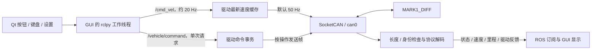
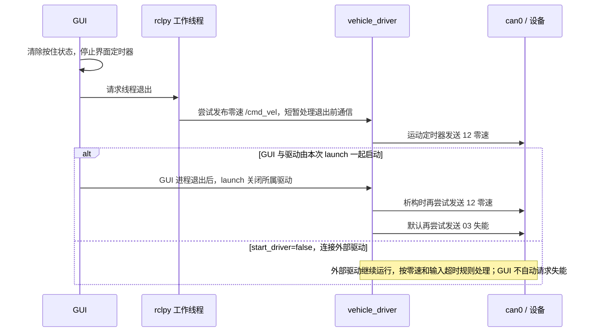

# GUI 功能与 CAN 帧对应关系

本文按 `ac694f9` 的实现于 2026-10-28 核对，说明当前 GUI 的每项操作如何通过 ROS 2 产生 CAN 帧，以及各显示项从哪些反馈取得数据。使用默认 [vehicle.yaml](../src/vehicle_driver/config/vehicle.yaml)，设备为 MARK1_DIFF，身份 `class=01 / type=E1 / node=01`。操作方法见 [GUI 使用说明](gui.md)，底层字段与实测边界见 [协议说明](protocol.md)。

## 1. 数据经过哪些层

GUI 不直接打开 CAN socket。所有设备命令由 `vehicle_driver` 编码和发送；Qt 绘图或表格刷新不会触发设备查询。

本页记法：

- CAN ID、功能码和数据字节均为**十六进制**；ROS 服务的 `command` 示例为**十进制**，例如 `command=17` 对应功能码 `0x11`。
- 所有正常设备帧都是经典 CAN 的 **29 位扩展数据帧**，500000 bit/s；不是 CAN FD，也不是远程请求帧。
- `ID = 0x01E10100 | 功能码`。若修改 `device_type/device_node`，对应 ID 和身份载荷随配置改变。
- DLC 是实际载荷长度；`D0` 为第一个字节。DLC=0 表示没有载荷，不是发送八个零。
- 多字节整数采用小端有符号布局。表中的 ID 不含 Linux 内部的 `CAN_EFF_FLAG`；该标志由 SocketCAN 适配器设置。
- 所有周期都是当前软件默认值或此前设备实测值，不是硬实时保证；运行参数、设备使能状态及总线调度均可能影响观察结果。

## 2. 运动控制：方向按钮、键盘和速度输入

### 2.1 运动帧如何组织

前进、后退、左转、右转、组合转弯及零速停止都使用 **同一个 ID `0x01E10112`，DLC=6**：

| 字节 | 编码 | 单位 |
|---|---|---|
| D0–D1 | `int16(round(vx × 1000))` | vx 输入单位 m/s |
| D2–D3 | `int16(0)`，固定 `00 00` | 差速底盘不请求横移 |
| D4–D5 | `int16(round(wz × 1000))` | wz 输入单位 rad/s |

GUI 默认直行幅值为 0.10 m/s、旋转幅值为 0.20 rad/s。以下均为这两个默认值下的完整六字节载荷：

| GUI 操作 | ROS `/cmd_vel` 中的 vx、wz | `0x01E10112` 数据 |
|---|---|---|
| 前进按钮 / W / ↑ | `+0.10, 0.00` | `64 00 00 00 00 00` |
| 后退按钮 / S / ↓ | `-0.10, 0.00` | `9C FF 00 00 00 00` |
| 左转按钮 / A / ← | `0.00, +0.20` | `00 00 00 00 C8 00` |
| 右转按钮 / D / → | `0.00, -0.20` | `00 00 00 00 38 FF` |
| 同时按住 W+A | `+0.10, +0.20` | `64 00 00 00 C8 00` |
| 停止运动 | `0.00, 0.00` | `00 00 00 00 00 00` |

同一轴的相反方向同时按住时相互抵消；松开一个方向但仍按住其他方向时，下一条命令采用剩余方向组合。仅松开最后一个方向，才结束这次持续运动。

修改速度输入框只改变 GUI 中的幅值，不单独发送一帧配置命令。没有方向按住时不会因此请求运动；方向仍按住时，下一次 GUI 续期采用新幅值。GUI 输入范围为直行 0–1 m/s、旋转 0–2 rad/s；方向决定正负。驱动另按自己的速度限幅参数处理，因此自定义驱动限幅后，GUI 发布值与实际编码值可能不同。

方向操作本身不发送 `03` 使能或 `11` 模式命令，只产生 `12`。设备是否执行 CAN 运动取决于其使能和模式；当前 GUI 不因按方向键而自动切换设备模式。

### 2.2 按住时的发送节奏

1. Qt 的 `pressed` / 非自动重复 `KeyPress` 更新方向集合，立即续期运动意图；之后 Qt 每 50 ms 续期一次。
2. rclpy 工作线程约每 50 ms 读取有效意图，发布一条 `/cmd_vel`。默认消息为带当前 ROS 时间戳的 `TwistStamped`；`use_stamped_cmd_vel=false` 时改为 `Twist`。
3. 驱动订阅回调只更新最新 vx/wz 缓存，不在每条 ROS 消息到达时立即发 CAN。其独立定时器默认每 20 ms 取缓存并发送一个 `0x01E10112`。
4. 因此抓包时常会看到同一个速度载荷连续出现多次。GUI 的约 20 Hz 发布与 CAN 的默认 50 Hz 发送是两个节奏，不是一条 ROS 消息只对应一个 CAN 帧。

`12` 没有本工程已知的 ACK；B2 反映设备报告的实际速度，不是对某一条 `12` 的逐帧应答。运动曲线中的“指令”取自 GUI 已发布的 ROS 值，“反馈”取自 B2，不能把指令曲线视为 CAN 发送抓包或实际轮速。

### 2.3 停止、超时与零速帧数量

| 触发 | GUI / 驱动行为 | CAN 上的表现 |
|---|---|---|
| 松开最后一个方向、点击停止、空格、Esc、窗口失焦 | GUI 清除按住状态；工作线程在下一次运动发送机会发布一次零速 ROS 命令 | 驱动下一次控制 tick 改发 `12#000000000000` |
| GUI 主线程卡住、不再续期 | 意图超过 200 ms 后，仍运行的工作线程发布一次零速；恢复时清除旧按住状态 | 后续发送零速；需要重新按下方向键才继续运动 |
| 整个 GUI 进程停止工作，未能发布零速 | 驱动在最后一条有效 ROS 速度超过 `command_timeout=0.30 s` 后清空缓存 | 默认下一控制 tick 发一次零速，随后停止重发该缓存 |
| 已收到过心跳，但后续超过 `heartbeat_timeout=1.50 s` | 驱动清空运动缓存；当前代码在每个控制 tick 都重新执行此检查 | 若 socket 仍可用，心跳持续过期期间会持续发送零速；socket 出错则进入断开/重连处理 |

**GUI “发布一次零速”不等于总线上只出现一个零速帧。** 正常松开时，零速本身也是一条新的有效 ROS 速度，驱动会以 50 Hz 重发它约 300 ms，输入过期时再发一次零速，然后静默。服务前置停速、设备使能状态变化和关闭流程也可能增加零速帧，不能据重复零速认定 GUI 重复点击。

普通停止只发送 `12` 的零速，不发送 `03` 失能或 `11` 刹车。设备此前实测约 500 ms 的断 CAN 运动命令保护属于固件层，与上述 GUI 200 ms 和驱动 300 ms 是不同层次。

## 3. 设备操作按钮：单次帧与应答

下表的设备按钮调用 `/vehicle/command`，类型为 `vehicle_interfaces/srv/Command`。每次有效点击对应一次服务请求；当前 GUI 在该请求未完成时禁用其他服务按钮，运动停止按钮仍可用。

| GUI 按钮 | ROS 请求关键字段（十进制 command） | 主命令 CAN ID / DLC / 数据 | 完成条件与显示依据 |
|---|---|---|---|
| 使能 | `command=3, enabled=true` | `0x01E10103` / 5 / `01 E1 01 01 01` | 收到 `0x01E101A3`（DLC=0），并且新的 B0 为 `01` |
| 失能 | `command=3, enabled=false` | `0x01E10103` / 5 / `01 E1 01 00 01` | 收到 A3，且新的 B0 为 `00` |
| 应用模式与蜂鸣器 | `command=17, mode=m, beep=b` | `0x01E10111` / 4 / `m b 00 00` | 等新的 B1 中 D1=所选模式、D4=蜂鸣器设置；没有已知 `11` ACK |
| 查询版本 | `command=2` | `0x01E10102` / 0 / 无载荷 | 收到 `0x01E101A2`（8 字节），解析两段各 4 字节 ASCII |
| 清故障 | `command=4` | `0x01E10104` / 1 / `CC` | 收到 `0x01E101A4`（DLC=0）；只确认接收，仍需观察故障/状态反馈 |
| 清运动计数 | `command=5` | `0x01E10105` / 1 / `CC` | 收到 `0x01E101A5`（DLC=0）；实际计数效果看 B3 左右里程和四路 B7 脉冲 |

模式字节 `m`：`00` 待机、`01` 遥控、`02` CAN、`03` 自由；蜂鸣器 `b` 为 `00/01`。例如选择 CAN 并勾选蜂鸣器，点击应用后主命令是 `01E10111#02010000`。更改下拉框或勾选框时不立即发帧，必须点击应用。

当前 GUI 没有刹车/特殊功能输入控件。服务请求中这两个字段保留默认 false，因此每次从 GUI 应用模式时 D2/D3 实际发送 `00 00`；不是“保留设备原值”，也不能由这两个发送值推断物理状态。

### 3.1 这些按钮是否先发零速

- 点击**使能、失能、应用模式、清运动计数**时，GUI 先清除按住状态，并安排发布零速 ROS 命令。
- 驱动收到**失能、应用模式、清运动计数**服务时，还会清空自己的速度缓存，在同一服务回调内先向 SocketCAN 写入 `01E10112#000000000000`，再写入上表主命令。这一前置顺序不依赖 GUI 零速消息何时到达。
- **使能**服务的驱动回调没有强制前置零速；它依赖 GUI 已结束手动运动。ROS 话题与服务是独立通道，不能保证 GUI 这一条零速与使能帧的跨通道先后顺序。
- **查询版本、清故障**按钮本身不清空运动意图，也不额外插入零速；如果还持有有效方向输入，运动帧与服务查询可以并行进行。

上述前置帧都是额外的 `12` 零速；主命令本身只发送一次，不因等待 ACK 周期重发。模式切换及 B0 使能变为失能时，驱动接收处理还会清空速度缓存，所以抓包可能包含更多零速帧。

### 3.2 等待、超时和结果的含义

驱动发送主命令后异步等待，默认 `service_timeout=1.20 s`；等待期间继续读取 CAN、发布遥测和执行运动定时器。驱动同一时刻只允许一个待反馈事务，忙时返回说明，不堆积新的设备命令。GUI 客户端最多等待约 3 s，不自动重试；客户端超时不等于已发送的设备操作被撤销。

界面的三项标志对应：

- **发送**：主命令已成功写入本地 SocketCAN；不能独立证明实际已经上总线或被执行。
- **应答**：收到匹配的 A2/A3/A4/A5；模式操作显示“不适用”。A3/A4/A5 的数据长度确实为零。
- **状态**：版本已解析，或新 B0 与目标使能一致，或新 B1 与目标 mode/beep 一致。清故障、清计数不自动将此标志设为已确认，因为它们的 ACK 不能证明全部物理效果。

例如 A3 已到、但 B0 没有变为目标状态时，结果可能是“应答已收到、状态未确认”。ACK 没有事务序号；本软件按功能码及新收到的状态匹配，不能从协议上排除另一控制进程的帧或极迟 ACK。当前安排要求同一设备由一个主动控制者操作。

若没有 CAN 连接或 ROS 服务尚不可用，操作会返回错误，不会排队到重连后补发旧动作。启动配置附近曾出现版本请求已经上总线而没有 A2 的现象，详见 [实际超时记录](gui.md#启动瞬间的查询超时)。当前 GUI 不把已有缓存版本当成本次查询成功，也没有为此增加自动重试。

## 4. 启动时自动安排哪些帧

默认 `./tools/dev.sh gui` 同时启动 GUI 与驱动，`auto_initialize=true`。以下动作属于驱动初始化，不是 GUI 轮询：

| 顺序 / 条件 | 发送帧 | 等待或后续动作 |
|---|---|---|
| 第一次收到目标设备 B0 | `01E10102#`，DLC=0 | 查询版本；不等待 A2 才进行下一步 |
| 此时 B0 表示失能 | `01E10103#01E1010101`，DLC=5 | 请求使能一次，等待后续 B0=01；初始化没有以 A3 为下一步前提 |
| B0 已使能，或后来变为使能 | `01E10111#02000000`，DLC=4 | 设置 CAN 模式、蜂鸣器/刹车/特殊功能发送值为 0 |
| 紧接上一条 | `01E10115#00`，DLC=1 | 默认关闭 B5 遥控反馈，由 `remote_feedback` 决定 |
| 紧接上一条 | `01E10116#00`，DLC=1 | 默认关闭 B6 传感反馈，由 `sensor_feedback` 决定 |
| 紧接上一条 | `01E10117#01`，DLC=1 | 默认开启 B7 驱动运动反馈，由 `driver_motion_feedback` 决定 |
| 紧接上一条 | `01E10118#01`，DLC=1 | 默认开启 B8 驱动状态反馈，由 `driver_status_feedback` 决定 |

如果第一次 B0 就为使能，跳过 `03`，在这次心跳处理中查询版本后立即发送模式与反馈配置。若使能状态一直未出现，初始化超时后停止等待，不反复发送使能。

模式与四个反馈开关是同一回调中的连续写入，没有逐帧 ACK 等待，也没有人为插入帧间休眠；表中顺序是程序写入顺序，实际总线发送时间以抓包为准。这也意味着不能把启动配置发送完成直接理解为设备已逐项确认执行。

初始化只执行一次，不定期抢回 CAN 模式、不周期重新使能、不清计数器、不发送设备复位。任何被驱动接受的显式 `/vehicle/command` 请求都会结束尚未完成的自动初始化；例如启动很早时点击查询版本，可能取消后续尚未执行的初始化步骤。`auto_initialize=false` 时不发送本节初始化帧。

`start_driver=false` 只连接已有驱动，不会因为 GUI 新接入而重复触发上述初始化。GUI 会接收驱动持久缓存的版本/状态；版本标签有值不代表 GUI 刚发送过查询。

当前 GUI 没有 B5/B6/B7/B8 独立开关按钮。它们可以通过 YAML 的启动配置或 `/vehicle/command` 服务设置（十进制 command=21/22/23/24），服务仅单次发送 `15/16/17/18`、载荷 `00/01`，没有已知 ACK；效果需观察对应反馈是否出现或停止。切换 GUI 页面不会改变这些开关。

## 5. GUI 显示项来自哪些接收帧

这些是设备主动反馈或命令应答，GUI 没有为每个数值逐个发查询。周期来自此前实机观察，主要是使能并开启相应反馈时的值；失能后部分反馈会停止，显示保留最后值并标记过期。

| GUI 显示 | ROS 来源 | CAN 来源和字段 | 接收节奏 / 含义 |
|---|---|---|---|
| 设备在线、已使能/失能 | `/vehicle/state` | `0x01E101B0`，DLC=1，D0=00/01 | B0 约 500 ms；在线还结合心跳年龄和本地接收年龄 |
| 电池电压、实际模式、工作状态、实际蜂鸣器、B1 D5 | `/vehicle/state` | `0x01E101B1`，实机 DLC=6；D0 工作状态，D1 模式，D2–D3 int16/10 V，D4 蜂鸣器，D5 原样保留 | 约 100 ms；D6/D7 不存在，不提供刹车/特殊功能状态 |
| 实际线速度/角速度、反馈曲线 | `/vehicle/velocity` | `0x01E101B2`，DLC=6；D0–D1 vx、D4–D5 wz，均 int16/1000 | 约 20 ms；D2–D3 的 vy 可被驱动解析，但当前 GUI 不单独展示 |
| 主轮累计左右里程 | `/vehicle/wheel_mileage` | `0x01E101B3`，DLC=8；D0–D3 左、D4–D7 右，int32 毫米 | 约 20 ms；GUI 除以 1000 显示米 |
| 四路 RPM、脉冲 | `/vehicle/driver_motion` | `0x01E101B7`，DLC=7；D0 通道，D1–D2 int16 RPM，D3–D6 int32 脉冲 | 总周期约 20 ms；通道 0–3 轮询，每通道约 80 ms |
| 四路电压、电流、温度、故障原始位 | `/vehicle/driver_status` | `0x01E101B8`，DLC=8；D0 通道，D1–D2 int16/10 V，D3–D4 int16/10 A，D5/D6 int8 驱动器/马达温度，D7 故障原始位 | 总周期约 100 ms；每通道约 400 ms；界面编号 1–4 对应通道 0–3 |
| 硬件/软件版本 | `/vehicle/version`；查询服务结果用于本次应答确认 | `0x01E101A2`，DLC=8；D0–D3 硬件 ASCII，D4–D7 软件 ASCII | 响应 `02`；不是周期帧。实机数据 `33 2E 30 00 34 2E 30 00` 表示 3.0 / 4.0 |
| 综合故障原始字段 | `/vehicle/faults` | `0x01E101BA`；沿用旧定义的前五字节 motor/driver/driver_offline/status_raw/power | 当前实机未观察到；GUI 显示“尚未收到”，不会解释成全部正常 |
| ACK 操作记录 | `/vehicle/acknowledgements`、服务结果 | `0x01E101A3/A4/A5`，DLC=0 | 事件触发；日志中的“发送”是请求记录，最终是否成功看返回结果 |
| 位姿、航向、轨迹 | `/odom` | 默认由 B2 的 vx/wz 按接收间隔积分；配置 `odom_source=wheel_mileage` 时由 B3 及标定轮距计算 | 没有“轨迹查询”CAN 帧；`/tf` 也是驱动计算发布，GUI 位姿显示直接订阅 `/odom` |
| 通信诊断、底部 RX/TX/丢帧计数 | `/diagnostics` | 驱动根据 socket、收发计数、B0/B1/B2 年龄等生成 | ROS 诊断约 500 ms 发布一次，不为此额外发 CAN 查询；TX 是写入成功计数，不是逐帧设备确认 |
| 整车 CAN 接收表 | `/vehicle/can_rx` | 接口筛选后的整车扩展数据帧，以及订阅的 CAN 错误帧 | 被动显示；不包含本 socket 自发帧或 `0x05` 类别底层驱动器报文 |

四路反馈由整车 B7/B8 聚合提供。GUI 不分别向四个 `0x05` 类别驱动器发送速度或查询命令。B4 副轮、B5 遥控和 B6 传感解析/ROS 接口存在，但当前 GUI 没有对应专用仪表；这些帧若被驱动接收到，仍可出现在原始接收表中。GUI 的主轮里程标签只使用 B3。

接收表的“累计帧数”是 GUI 自己收到该 ID 的消息次数。它采用 best-effort 订阅，不能等同于总线上绝无遗漏的计数，也可能与 `/diagnostics` 的驱动 RX 计数不同。若要核对本驱动发送的 `12/03/11`，需要独立 SocketCAN 抓包；不能要求它们自动回显到本 socket 的接收表。

GUI 主显示/绘图定时器为 50 ms，表格最多约每 250 ms 更新一次。这些是显示刷新周期，与设备上报周期、CAN 发送周期分别计时。

## 6. 只影响本地显示或 ROS 状态的功能

| GUI 功能 | 实际行为 | 是否增加设备 CAN 命令 |
|---|---|---|
| 重置本地位姿 | 调用 `/vehicle/reset_odometry`（`std_srvs/Trigger`），重置驱动内的 ROS 位姿及积分基线；新的位姿在后续 odom 消息中更新 | 不发 `05`，不清 B3/B7；该操作本身也不请求停速 |
| 清空图表 | 清除 GUI 的速度/指令/odom 历史缓冲；不清最新状态、不重置 ROS 位姿；后续数据继续绘制 | 无 |
| 导出曲线 CSV | 先结束手动运动并安排一次零速 ROS 命令，再打开文件对话框、保存本地历史；取消对话框也已经触发停止 | 只增加停止路径的 `12` 零速；没有专用导出帧 |
| 切换“运动监测 / 诊断与 CAN”、缩放曲线、查看记录 | 本地显示操作；ROS 订阅持续接收 | 无；不自动关闭 B7/B8、不重新查询版本 |
| 只编辑速度、模式、蜂鸣器设置 | 修改待使用/待应用值；速度在方向仍按住时由下一次续期采用，模式/蜂鸣器需点击应用 | 没有独立编辑帧；持续运动和应用按钮行为见前文 |

“清空图表”“重置本地位姿”“清运动计数”作用在三个不同位置。清运动计数才发送 `05 CC`；驱动在清计数时重建里程基线但保留已有 ROS 位姿，GUI 历史也不会因此自动清空。重置位姿本身同样不清 GUI 轨迹历史；需要清除旧轨迹时另点“清空图表”。

## 7. 关闭窗口时的安排

驱动正常析构时，发送顺序为 `01E10112#000000000000`，再按 `disable_on_shutdown=true` 发送 `01E10103#01E1010001`。这是退出时的尽力发送，不再等待 A3/B0；不能仅凭窗口已关闭就推断失能已确认。GUI 验收脚本在关闭窗口前显式点击失能，并观察 A3/B0、保存状态；这与析构阶段不等待反馈是两件事。设为 `disable_on_shutdown=false` 时，驱动退出只尝试发零速。

GUI 工作线程退出前会尝试发布零速并短暂处理通信，实际零速能否在驱动退出前经 DDS 到达取决于调度；同一次 launch 所属驱动的析构还会独立尝试直接发送 CAN 零速。异常终止进程或 socket 已断开时，不能保证走完正常关闭步骤。

## 8. 代码与证据入口

- [window.py](../src/vehicle_gui/vehicle_gui/window.py)：`_controls`、`_diagnostic_page` 定义按钮；`_renew_motion`、`_command`、`stop_controls`、`export_csv`、`closeEvent` 定义输入和停止行为。
- [model.py](../src/vehicle_gui/vehicle_gui/model.py)：`MotionLease` 的 200 ms 有效期和一次零速；[ros_worker.py](../src/vehicle_gui/vehicle_gui/ros_worker.py) 负责 ROS 发布周期、异步服务和退出。
- [vehicle_node.cpp](../src/vehicle_driver/src/vehicle_node.cpp)：`initialize_after_heartbeat`、`command_request`、`check_pending`、`control_tick` 和析构函数决定实际 CAN 发送安排。
- [control.hpp](../src/vehicle_core/include/vehicle_core/control.hpp)、[protocol.cpp](../src/vehicle_core/src/protocol.cpp)、[socketcan.cpp](../src/vehicle_core/src/socketcan.cpp)：最新速度缓存、字节编码和实际 socket 写入。
- [console.launch.py](../src/vehicle_gui/launch/console.launch.py)：GUI 退出与所属驱动关闭之间的关系。
- [协议及实机验收](validation.md)、[GUI 验证记录](gui.md#验证与证据)：原始抓包、JSON、截图和已知限制。本页解释现有实现，不把尚未实测的字段或物理效果补成已验证。
