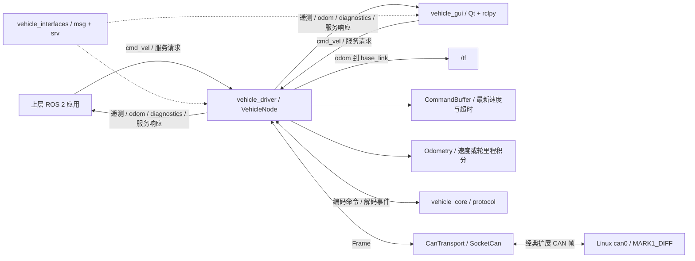

# ROS 2 工程架构、通讯接口与数据结构

本文于 2026-10-28 按当前工作树核对，面向上层应用、GUI 和底盘驱动的开发与接入。默认环境为 ROS 2 Jazzy，底盘为 MARK1_DIFF，驱动节点为 `/vehicle`。文中的名称、参数和 QoS 均指默认配置；namespace、remap 和自定义配置会改变实际接口。

当前工程有四个包、两个应用节点，提供 **15 个应用话题（含 `/tf`）和 2 个业务服务**，定义 10 种自定义消息和 1 种自定义服务，尚未实现 action。框架自动提供的参数、日志等接口另见下文。

## 1. 代码与文档入口

| 内容 | 实现 / 定义 |
|---|---|
| ROS 节点、话题、服务与定时器 | [vehicle_node.cpp](../src/vehicle_driver/src/vehicle_node.cpp) |
| 自定义消息与服务 | [msg](../src/vehicle_interfaces/msg/)、[Command.srv](../src/vehicle_interfaces/srv/Command.srv) |
| 默认配置 | [vehicle.yaml](../src/vehicle_driver/config/vehicle.yaml) |
| CAN 帧、协议事件与编解码 | [protocol.hpp](../src/vehicle_core/include/vehicle_core/protocol.hpp)、[protocol.cpp](../src/vehicle_core/src/protocol.cpp) |
| 速度缓存与里程计 | [control.hpp](../src/vehicle_core/include/vehicle_core/control.hpp)、[odometry.cpp](../src/vehicle_core/src/odometry.cpp) |
| GUI 的 ROS 适配层 | [ros_worker.py](../src/vehicle_gui/vehicle_gui/ros_worker.py) |
| 工程取舍 / CAN 字节协议 / GUI 操作时序 | [架构说明](architecture.md)、[协议说明](protocol.md)、[GUI 与 CAN 对照](gui-can.md) |

## 2. 工程架构

### 2.1 包与节点边界

| 包 | 职责 | 运行实体 |
|---|---|---|
| `vehicle_core` | 纯 C++ CAN 编解码、非阻塞 SocketCAN、速度缓存、里程积分；不依赖 ROS | 库，无独立 ROS 节点 |
| `vehicle_interfaces` | 生成 `.msg` 和 `.srv` 对应的 ROS 类型，供驱动和客户端共用 | 接口包，无独立 ROS 节点 |
| `vehicle_driver` | 将 ROS 控制输入转成 CAN，管理设备会话、应答、遥测、里程计、TF 和诊断 | 可执行程序 `vehicle_node`；节点默认 `/vehicle`；组件类 `vehicle_driver::VehicleNode` |
| `vehicle_gui` | PyQt5 / PyQtGraph 展示与人工控制，通过 rclpy 接入驱动 | 可执行程序 `vehicle_gui`；节点默认 `/vehicle_gui` |



`vehicle_driver` 持有 CAN socket，GUI 和上层应用只使用 ROS 接口。同一设备应只有一个主动驱动实例；多个速度发布者之间没有内置优先级或控制权仲裁，接入多个控制来源时需在上层统一选择有效输入。

### 2.2 数据流与执行时序

| 路径 | 当前行为 |
|---|---|
| 速度输入 | `/cmd_vel` 回调校验后更新一个最新值缓存，不建立运动命令队列 |
| 速度输出 | 独立定时器按 `command_rate` 取缓存，默认 50 Hz，经协议库编码后发送 CAN `0x12` |
| CAN 接收 | 每 2 ms 非阻塞轮询，一次最多处理 256 帧；先发布接收帧，再解码为类型化事件 |
| 遥测发布 | 对应 CAN 事件到达后发布；大部分遥测没有独立的 ROS 发布周期 |
| 里程计 / TF | 选定的反馈源完成一次有效积分后发布；首个样本、间隔异常或重建基线时可能不发布 |
| 服务事务 | 保存待应答请求，由后续 CAN 事件或超时完成响应；等待期间继续收发、发布和执行速度定时器 |
| 状态 / 诊断 | 每 500 ms 发布；状态还在 B0 / B1 到达时发布 |

驱动所有回调共用默认的互斥 callback group，加载到多线程组件容器时也串行访问设备会话。超时、反馈年龄和里程积分使用单调时钟；ROS 时钟用于消息时间戳及带时间戳速度命令的年龄检查。

GUI 主线程处理 Qt，`RosWorker` 在线程中运行 rclpy `SingleThreadedExecutor`，通过线程安全的 `TelemetryStore` 与界面交换快照。GUI 有效手动运动意图约每 50 ms 发布一次；其约 20 Hz 的 ROS 发布与驱动默认 50 Hz 的 CAN 发送相互独立。界面运动意图默认需在 200 ms 内续期。

### 2.3 启动、失联与退出

- 默认收到目标 B0 心跳后查询版本；若设备失能则发送一次使能，观察到使能心跳后发送一次 CAN 模式及四种反馈开关。自动初始化不清计数器，不循环抢回模式或使能。
- 显式设备命令会接管尚未完成的自动初始化。失能、切模式、清设备运动计数和复位会清空速度缓存，并先尝试发送零速。
- 已收到的心跳超过 `heartbeat_timeout` 后清空速度缓存。SocketCAN I/O 错误或 bus-off 会断开 socket、丢弃旧速度、重建里程基线，每秒尝试重新打开。
- 正常析构时尝试直接发送 CAN 零速；`disable_on_shutdown=true` 时再尝试失能。异常终止或总线不可用时不能据此断言设备已停止。

## 3. 命名、单位和 QoS 约定

### 3.1 namespace 与节点私有名称

| 代码中的名称 | 默认解析结果 | namespace 为 `robot1` 时 |
|---|---|---|
| `cmd_vel` | `/cmd_vel` | `/robot1/cmd_vel` |
| `odom` | `/odom` | `/robot1/odom` |
| `diagnostics` | `/diagnostics` | `/robot1/diagnostics` |
| `~/state` 等私有话题 | `/vehicle/state` | `/robot1/vehicle/state` |
| `~/command`、`~/reset_odometry` | `/vehicle/command`、`/vehicle/reset_odometry` | `/robot1/vehicle/command`、`/robot1/vehicle/reset_odometry` |
| TF 广播器的 `/tf` | `/tf` | `/tf`，需要时显式 remap |

重命名驱动节点会改变 `~/...` 接口。GUI 使用参数 `driver_name`（默认 `vehicle`）拼接这些接口，需与实际驱动名称对应；`cmd_vel`、`odom`、`diagnostics` 仍按 GUI 所处 namespace 解析。namespace 不会自动给 `odom_frame`、`base_frame` 添加前缀，多底盘部署时还应配置不同的坐标系名称。

`/tf` 的绝对名称和默认 QoS 来自 Jazzy 的 [TransformBroadcaster](https://github.com/ros2/geometry2/blob/jazzy/tf2_ros/include/tf2_ros/transform_broadcaster.hpp) 与 [DynamicBroadcasterQoS](https://github.com/ros2/geometry2/blob/jazzy/tf2_ros/include/tf2_ros/qos.hpp)。本驱动没有静态 TF 广播器。

### 3.2 公共数据约定

- ROS 速度和位姿使用 SI 单位：线速度 m/s、角速度 rad/s、位置 m、角度 rad；明确带 `_mm` 的字段仍为毫米。
- `Header` 包含 `stamp`（`builtin_interfaces/Time`）和 `frame_id`（`string`）。`Time` 包含 `sec: int32`、`nanosec: uint32`。
- 接收遥测的时间戳是驱动从 socket 取出帧时的 ROS 时间，不是设备或 CAN 硬件时间戳。除 odometry / TF 等下文单列项外，带 Header 的驱动输出使用 `base_frame`，默认 `base_link`。
- “未收到”与“数值为零”含义不同。除 `State` 的显式有效位外，订阅者需自行保留接收时间和有效性，不能用消息的默认零值认定设备正常。

### 3.3 QoS 记法

下表均使用 `KeepLast`；`R` 表示 reliable，`BE` 表示 best-effort，`V` 表示 volatile，`TL` 表示 transient-local，末尾数字为深度。例如 `BE / V / 5` 对应当前 `SensorDataQoS`。

订阅 QoS 需与发布端兼容。尤其是 `BE` 遥测发布端不能满足要求 `R` 的订阅端；`TL` 状态与版本支持后启动订阅者获取缓存样本，但缓存本身不保证反馈新鲜。可用 `ros2 topic info -v` 检查实际端点。

## 4. Topic：应用话题清单

方向均以驱动节点 `/vehicle` 为参照。CAN 功能码对应默认身份 `0x01E101xx` 的最后一个字节。

| 默认 topic | 消息类型 | 驱动方向 | QoS | 发布 / 触发时机 |
|---|---|---|---|---|
| `/cmd_vel` | `geometry_msgs/msg/TwistStamped`；可配置为 `Twist` | 订阅 | R / V / 1 | 上层持续更新速度；GUI 有效运动时约 20 Hz |
| `/vehicle/velocity` | `geometry_msgs/msg/TwistStamped` | 发布 | BE / V / 5 | B2 到达；实测约 20 ms 一帧 |
| `/vehicle/state` | `vehicle_interfaces/msg/State` | 发布 | R / TL / 1 | B0 / B1 到达，以及每 500 ms |
| `/vehicle/version` | `vehicle_interfaces/msg/Version` | 发布 | R / TL / 1 | 收到版本应答 A2 |
| `/vehicle/wheel_mileage` | `vehicle_interfaces/msg/WheelMileage` | 发布 | BE / V / 5 | B3 / B4 到达；B3 实测约 20 ms |
| `/vehicle/driver_motion` | `vehicle_interfaces/msg/DriverMotion` | 发布 | BE / V / 5 | B7 到达；四通道总周期实测约 20 ms |
| `/vehicle/driver_status` | `vehicle_interfaces/msg/DriverStatus` | 发布 | BE / V / 5 | B8 到达；四通道总周期实测约 100 ms |
| `/vehicle/remote` | `vehicle_interfaces/msg/Remote` | 发布 | BE / V / 5 | B5 到达；可用反馈开关控制 |
| `/vehicle/sensors` | `vehicle_interfaces/msg/Sensors` | 发布 | BE / V / 5 | B6 到达；当前实机未观察到 |
| `/vehicle/faults` | `vehicle_interfaces/msg/Faults` | 发布 | R / V / 10 | BA 到达；当前实机未观察到 |
| `/vehicle/acknowledgements` | `vehicle_interfaces/msg/Acknowledgement` | 发布 | R / V / 10 | A3 / A4 / A5 到达 |
| `/vehicle/can_rx` | `vehicle_interfaces/msg/CanFrame` | 发布 | BE / V / 128 | socket 接收到的每个筛选后数据帧 / 错误帧 |
| `/odom` | `nav_msgs/msg/Odometry` | 发布 | R / V / 10 | 选定反馈源完成有效积分 |
| `/tf` | `tf2_msgs/msg/TFMessage` | 发布 | R / V / 100，TF 默认值 | 与 `/odom` 同步；`publish_tf=false` 时不创建广播器 |
| `/diagnostics` | `diagnostic_msgs/msg/DiagnosticArray` | 发布 | R / V / 10 | 每 500 ms，2 Hz |

CAN 实测周期是现有固件的观察结果，不是驱动承诺的固定 ROS 频率，详见[协议说明](protocol.md)。驱动不为缺失的 B4、B6 或 BA 构造模拟消息。

GUI 当前发布 `/cmd_vel`，订阅 state、version、velocity、wheel_mileage、driver_motion、driver_status、faults、acknowledgements、can_rx、odom 和 diagnostics，并调用下文两个业务服务。它没有 remote、sensors 或 TF 的专用订阅。

## 5. 速度输入与标准消息结构

### 5.1 `/cmd_vel`：速度设定值

默认 `use_stamped_cmd_vel=true`：

| 字段 | 类型 | 解释 |
|---|---|---|
| `header` | `std_msgs/Header` | `stamp` 用于命令年龄检查；驱动不根据 `frame_id` 进行坐标变换 |
| `twist` | `geometry_msgs/Twist` | 包含 `linear` 和 `angular` 两个 `Vector3`，各轴均为 `float64` |
| `twist.linear.x` | `float64` | 底盘前后线速度，m/s |
| `twist.angular.z` | `float64` | 底盘偏航角速度，rad/s |
| `twist.linear.y / z`、`twist.angular.x / y` | `float64` | 有限的非零值会被忽略并限频提示；任一轴 NaN / Inf 都会拒绝整条输入并清空旧指令 |

当 `use_stamped_cmd_vel=false` 时，同一话题改用 `geometry_msgs/msg/Twist`，字段直接为 `linear`、`angular`，不含 Header。发布者和驱动必须使用相同类型，不能同时向该入口混发两种类型。

处理规则：

1. 非零时间戳：拒绝年龄超过 `command_timeout` 的旧命令，以及超过当前 ROS 时间 100 ms 的未来命令。零时间戳：跳过来源时间检查，以本地接收时刻开始输入超时计时。
2. 校验通过后缓存最新 `vx / wz`，按 `max_linear_speed` 和 `max_angular_speed` 对称限幅；默认分别为 1 m/s 和 2 rad/s。即使消息带来源时间戳，缓存超时仍从本地接收时刻计时。
3. 独立定时器默认每 20 ms 发送一次 CAN 速度，固定 `vy=0`。ROS 发布频率和 CAN 发送频率不需要一一对应。
4. 本地接收后默认 300 ms 没有新有效输入，则在控制定时器中发出一次零速并结束该旧命令的周期重发。设备另有此前实测约 500 ms 的断命令保护，属于不同层的超时机制。

该接口表达持续更新的速度设定值，不提供目标完成通知。当前没有定距、定角或导航 action。

### 5.2 `/vehicle/velocity`：原始速度反馈

同样使用 `TwistStamped`，`header.frame_id=base_frame`。`twist.linear.x / y` 和 `twist.angular.z` 分别来自 B2 的 `vx / vy / wz`，三个有符号 int16 原始量均除以 1000；其余轴保持默认零值。驱动不对它做平滑或死区处理。

反馈保留 B2 的 `vy`，但当前差速控制入口和里程积分只使用 `vx / wz`。

### 5.3 `/odom`：位姿与速度

使用标准 [nav_msgs/msg/Odometry](https://github.com/ros2/common_interfaces/blob/jazzy/nav_msgs/msg/Odometry.msg)。位姿在 `header.frame_id` 中表达，速度在 `child_frame_id` 中表达。

| 字段 / 子结构 | 类型 | 当前填充内容 |
|---|---|---|
| `header` | `std_msgs/Header` | 帧时间；`frame_id=odom_frame`，默认 `odom` |
| `child_frame_id` | `string` | `base_frame`，默认 `base_link` |
| `pose` | `geometry_msgs/PoseWithCovariance` | 含 `pose: Pose` 与 `covariance: float64[36]` |
| `pose.pose.position` | `geometry_msgs/Point`，x/y/z 均为 `float64` | 积分得到 x、y，单位 m；z=0 |
| `pose.pose.orientation` | `geometry_msgs/Quaternion`，x/y/z/w 均为 `float64` | 平面偏航四元数：x=y=0，z=sin(yaw/2)，w=cos(yaw/2) |
| `twist` | `geometry_msgs/TwistWithCovariance` | 含 `twist: Twist` 与 `covariance: float64[36]` |
| `twist.twist` | `geometry_msgs/Twist` | `linear.x=vx`、`angular.z=yaw_rate`，其余轴为零 |

两个协方差数组按 6×6 行优先存储，轴顺序为 x、y、z、绕 x、绕 y、绕 z。当前只写对角线，其他项为零：

| 协方差数组 | 索引 0（x） | 索引 7（y） | 索引 35（偏航） | 其余对角线 |
|---|---|---|---|---|
| `pose.covariance` | `pose_variance_xy` | `pose_variance_xy` | `pose_variance_yaw` | 索引 14 / 21 / 28 为 `1e6` |
| `twist.covariance` | `twist_variance_linear` | `1e6` | `twist_variance_angular` | 索引 14 / 21 / 28 为 `1e6` |

`odom_source=velocity` 默认按 B2 的 `vx / wz` 做 SE(2) 圆弧积分；`wheel_mileage` 则只使用 B3 主轮累计值，需要已标定的 `effective_track_width>0`。首个反馈只建基线，间隔超过 250 ms 或轮里程异常增量时重建基线，保留位姿。协方差是配置估计，当前反馈和里程计精度不能等同于外部定位真值。

### 5.4 `/tf`：坐标变换

消息为 `tf2_msgs/msg/TFMessage`，字段 `transforms` 是 `geometry_msgs/TransformStamped[]`。每次发布里程计时，当前驱动放入一条相同位姿的变换：

| `transforms[]` 中的字段 | 类型 | 当前内容 |
|---|---|---|
| `header` | `std_msgs/Header` | 时间戳与 odom 一致；`frame_id=odom_frame` |
| `child_frame_id` | `string` | `base_frame` |
| `transform.translation` | `geometry_msgs/Vector3`，x/y/z 均为 `float64` | x、y 与里程计一致，z=0 |
| `transform.rotation` | `geometry_msgs/Quaternion`，x/y/z/w 均为 `float64` | 与里程计偏航四元数一致 |

此处发布 `odom → base_link`；当前工程不生成 `map → odom`。

## 6. 自定义遥测消息结构

本节覆盖 [vehicle_interfaces/msg](../src/vehicle_interfaces/msg/) 的全部 10 个消息文件。每种消息的 `header: std_msgs/Header` 均遵循第 3 节约定，下面列出其余所有字段。

### 6.1 `State`：整车状态

对应 `/vehicle/state`，合并 B0 心跳和 B1 状态。

| 字段 | 类型 | 来源 / 含义 |
|---|---|---|
| `heartbeat_stamp` | `builtin_interfaces/Time` | 最近一次 B0 的接收 ROS 时间 |
| `status_stamp` | `builtin_interfaces/Time` | 最近一次 B1 的接收 ROS 时间 |
| `heartbeat_received` | `bool` | 是否曾收到有效 B0；用于判断 enabled 是否有来源 |
| `status_received` | `bool` | 是否曾收到有效 B1；用于判断后续 B1 字段是否有来源 |
| `online` | `bool` | socket 存在且最近 B0 年龄小于 `heartbeat_timeout` |
| `enabled` | `bool` | 最近 B0 中的使能值 |
| `work_state` | `uint8` | B1 D0 原始工作状态；当前诊断将非零值视为异常，不推断具体故障含义 |
| `mode` | `uint8` | B1 D1；0 待机、1 遥控、2 CAN、3 自由 |
| `battery_voltage` | `float64` | B1 D2–D3 有符号小端 int16 / 10，单位 V |
| `beep` | `bool` | B1 D4 是否非零 |
| `flags_raw` | `uint8` | B1 D5 原始值，尚未验证各位语义 |

`header.stamp` 会随 2 Hz 的状态重发布更新，**不能代替 `heartbeat_stamp` 或 `status_stamp` 判断底层反馈新鲜度**。两个 received 标志表示曾收到，不表示当前仍新鲜；`online` 只判断心跳和 socket，也不代表 B1 / B2 正常。失联时其他字段仍可能保留旧值。

消息中没有刹车或特殊功能的实际状态字段；不能将 `flags_raw` 擅自解释成这些布尔值。

### 6.2 `Version`：设备版本

对应 `/vehicle/version`，来自 A2。

| 字段 | 类型 | 含义 |
|---|---|---|
| `hardware` | `string` | 前 4 字节 ASCII 硬件版本，遇零终止 |
| `software` | `string` | 后 4 字节 ASCII 软件版本，遇零终止 |

两段均允许恰好 4 个字符；非法非打印字符会导致该帧解析失败。TL 保留最后一次应答，不会因新订阅者加入而重新查询设备。

### 6.3 `WheelMileage`：主轮 / 副轮累计里程

对应 `/vehicle/wheel_mileage`。

| 字段 | 类型 | 含义 |
|---|---|---|
| `left_mm` | `int32` | 左轮有符号累计里程，mm |
| `right_mm` | `int32` | 右轮有符号累计里程，mm |
| `secondary` | `bool` | false=B3 主轮；true=B4 副轮 |

当前实机未观察到 B4。累计值可被设备清零并会发生 int32 回绕；轮里程积分用模运算计算差值。原始消息仍保留设备累计值。

### 6.4 `DriverMotion`：四路驱动器运动反馈

对应 `/vehicle/driver_motion`，来自整车聚合 B7。

| 字段 | 类型 | 含义 |
|---|---|---|
| `channel` | `uint8` | 0–3；超出范围的 CAN 帧被拒绝 |
| `driver_id` | `uint8` | `channel+1`，即 1–4 |
| `rpm` | `int16` | 有符号转速，RPM |
| `pulses` | `int32` | 有符号累计脉冲 |

一条消息对应一个通道，不是含四个驱动器的数组；`driver_id` 由驱动根据 channel 生成，不是从下游 `0x05` 类别帧读取。

### 6.5 `DriverStatus`：四路驱动器电气与温度反馈

对应 `/vehicle/driver_status`，来自整车聚合 B8。

| 字段 | 类型 | 含义 |
|---|---|---|
| `channel` | `uint8` | 0–3 |
| `driver_id` | `uint8` | `channel+1`，即 1–4 |
| `voltage` | `float64` | B8 有符号 int16 / 10，单位 V |
| `current` | `float64` | B8 有符号 int16 / 10，单位 A |
| `driver_temperature` | `int8` | 驱动器温度协议整数，未缩放 |
| `motor_temperature` | `int8` | 电机温度协议整数，未缩放 |
| `faults_raw` | `uint8` | B8 D7 原始故障位；具体位定义未完成硬件验证 |

温度字段保留协议整数，当前实现没有温度换算或独立标定逻辑。

### 6.6 `Remote`：遥控器反馈

对应 `/vehicle/remote`，来自 B5。

| 字段 | 类型 | 含义 |
|---|---|---|
| `switches` | `uint8[4]` | B5 D0 从低位到高位拆成四个 2-bit 值，每项 0–3 |
| `axes` | `int8[6]` | B5 D1–D6，六个有符号原始摇杆量，不归一化 |

当前不把数组项强制命名为具体摇杆轴；实机摇杆变化尚未验证。默认不主动开启 B5 反馈。

### 6.7 `Sensors`：传感器原始反馈

对应 `/vehicle/sensors`，来自 B6。

| 字段 | 类型 | 含义 |
|---|---|---|
| `bumper_mask` | `uint8` | 按旧协议保留的碰撞位原始值 |
| `ultrasonic_raw` | `uint8[6]` | 六路传感原始值，不假定距离单位或有效范围 |

当前设备未观察到 B6，布局沿用旧定义，默认不主动开启该反馈。

### 6.8 `Faults`：整车故障原始码

对应 `/vehicle/faults`，来自 BA；五个字段依次对应其前五字节。

| 字段 | 类型 | 含义 |
|---|---|---|
| `motor` | `uint8` | 电机故障原始码 |
| `driver` | `uint8` | 驱动器故障原始码 |
| `driver_offline` | `uint8` | 驱动器离线原始码 |
| `status_raw` | `uint8` | 原始状态码 |
| `power` | `uint8` | 电源故障原始码 |

BA 布局来自旧定义，尚未通过主动制造硬件故障验证；不能据字段名称扩展出未经验证的错误码表。

### 6.9 `Acknowledgement`：命令接收应答

对应 `/vehicle/acknowledgements`。

| 字段 | 类型 | 含义 |
|---|---|---|
| `command` | `uint8` | A3→3（ENABLE）、A4→4（CLEAR_FAULTS）、A5→5（ZERO_MOTION） |

三个 ACK 的 CAN 载荷均为零。消息里的 `command` 是原命令码，不是 `0xA3 / 0xA4 / 0xA5`。A2 版本应答通过 Version 发布，不产生此消息。ACK 表示接收确认，不证明操作的全部物理效果。

### 6.10 `CanFrame`：筛选后的原始 CAN 接收帧

对应 `/vehicle/can_rx`。

| 字段 | 类型 | 含义 |
|---|---|---|
| `id` | `uint32` | 去除 Linux EFF / RTR / ERR 标志后的 ID；错误帧时保留错误类别掩码 |
| `length` | `uint8` | 有效数据长度 0–8 |
| `data` | `uint8[8]` | 固定长度数组；只读取前 `length` 字节 |
| `extended` | `bool` | 是否扩展帧 |
| `remote` | `bool` | 是否远程请求帧 |
| `error` | `bool` | 是否 SocketCAN 错误帧 |

这是接收观测接口，没有对应的任意 CAN 发送 topic。正常数据只包含配置身份的整车扩展数据帧，另包含订阅的总线错误帧；不包含本 socket 自发帧，也不包含 `0x05` 类别下游驱动器帧。帧通过 socket 接收后先发布，再做协议解析，因此未知功能码或长度不合法的数据也可能在此可见，但不产生类型化遥测。

## 7. `/diagnostics` 数据结构

消息为 `diagnostic_msgs/msg/DiagnosticArray`，包含 `header: std_msgs/Header` 和 `status: DiagnosticStatus[]`。当前驱动每次写入一个状态项，设置 `header.stamp`，其 `frame_id` 保持空字符串。

| `status[]` 字段 | 类型 | 当前内容 |
|---|---|---|
| `level` | `byte` | 0=OK、1=WARN、2=ERROR；标准类型另定义 3=STALE |
| `name` | `string` | 驱动全名加 `/socketcan`，默认 `/vehicle/socketcan` |
| `message` | `string` | 面向人的诊断说明 |
| `hardware_id` | `string` | `<can_interface>:<address.base() 的十进制值>` |
| `values` | `diagnostic_msgs/KeyValue[]` | 每项含 `key: string`、`value: string`，数值通过字符串表达 |

级别定义见官方 [DiagnosticStatus.msg](https://github.com/ros2/common_interfaces/blob/jazzy/diagnostic_msgs/msg/DiagnosticStatus.msg)。当前诊断按以下先后顺序判断：socket / 心跳失效为 ERROR；已使能且 B1 超过 0.5 s 或 B2 超过 0.2 s 为 WARN；已收到 B1 且 work_state 非零为 ERROR；其余为 OK，包括正常在线但失能。

| `values[].key` | 字符串中的含义 |
|---|---|
| `heartbeat_age_s` | B0 年龄，s；尚未收到时为负值 |
| `status_age_s` | B1 年龄，s；尚未收到时为负值 |
| `velocity_age_s` | B2 年龄，s；尚未收到时为负值 |
| `rx_frames` | 驱动累计接收帧数，含 CAN 错误帧 |
| `tx_frames` | 通过驱动 `transmit()` 成功写入 socket 的帧数，不是设备逐帧确认数 |
| `malformed_frames` | 协议解码判定格式不合法的帧数 |
| `can_error_frames` | 收到的 SocketCAN 错误帧数 |
| `rx_errors` / `tx_errors` | socket 接收 / 发送异常累计次数 |
| `socket_dropped_frames` | 当前 socket 报告的接收队列丢帧数；无 socket 时为 0，重建 socket 后重新计数 |
| `rejected_commands` | 被拒绝的速度输入累计次数 |
| `command_active` | 速度缓存当前有效性，字符串形式的 0 / 1 |
| `odometry_discontinuities` | 里程积分检测到不连续的累计次数 |

GUI 的接收表计数来自自己的 best-effort 订阅，不保证与驱动 `rx_frames` 一致。

## 8. Service：业务服务及请求 / 响应结构

两个业务服务使用 ROS 默认 service QoS（reliable / volatile），客户端应异步调用。`/vehicle/command` 默认等待反馈上限为 `service_timeout=1.2 s`；GUI 客户端最多等约 3 s，不自动重试。客户端取消等待不等于撤销已经发送的设备命令。

### 8.1 `/vehicle/command`

类型为 [vehicle_interfaces/srv/Command](../src/vehicle_interfaces/srv/Command.srv)。

请求全部字段：

| 字段 | 类型 | 用途 |
|---|---|---|
| `command` | `uint8` | 下表命令常量 |
| `enabled` | `bool` | ENABLE 或四种反馈开关使用 |
| `mode` | `uint8` | SET_MODE 使用；0 待机、1 遥控、2 CAN、3 自由 |
| `beep` | `bool` | SET_MODE 的蜂鸣器请求 |
| `brake` | `bool` | SET_MODE 的刹车请求；实际状态反馈不可用 |
| `special` | `bool` | SET_MODE 的特殊功能请求；实际状态反馈不可用 |

数值均列为十进制，同时给出对应 CAN 十六进制功能码：

| 常量 | `command` | CAN 发送码 | 有效请求字段 | 当前响应完成条件 |
|---|---:|---|---|---|
| `RESET` | 1 | `0x01` | 无额外字段 | 单次发送后立即返回，不等待 ACK，不宣称复位 / 恢复成功 |
| `QUERY_VERSION` | 2 | `0x02` | 无额外字段 | 收到并解析 A2；填写版本并置 acknowledged、state_confirmed |
| `ENABLE` | 3 | `0x03` | `enabled` | 同时收到 A3 和新的、enabled 与请求匹配的 B0 |
| `CLEAR_FAULTS` | 4 | `0x04` | 无额外字段 | 收到 A4；不宣称故障物理原因已消除 |
| `ZERO_MOTION` | 5 | `0x05` | 无额外字段 | 收到 A5；清设备里程 / 脉冲，ROS 位姿保留并重建积分基线 |
| `SET_MODE` | 17 | `0x11` | `mode / beep / brake / special` | 新 B1 的 mode / beep 匹配；刹车、特殊功能不在确认范围 |
| `REMOTE_FEEDBACK` | 21 | `0x15` | `enabled` | 发送后立即返回，无已知 ACK；观察 B5 |
| `SENSOR_FEEDBACK` | 22 | `0x16` | `enabled` | 发送后立即返回，无已知 ACK；观察 B6 |
| `DRIVER_MOTION_FEEDBACK` | 23 | `0x17` | `enabled` | 发送后立即返回，无已知 ACK；观察 B7 |
| `DRIVER_STATUS_FEEDBACK` | 24 | `0x18` | `enabled` | 发送后立即返回，无已知 ACK；观察 B8 |

请求未使用的字段被忽略。未知命令或不在 0–3 的 mode 会被拒绝；速度码 `0x12` 不通过此服务执行。

响应全部字段：

| 字段 | 类型 | 语义 |
|---|---|---|
| `sent` | `bool` | 主命令写入本地 SocketCAN 成功；不表示已经上总线或执行成功 |
| `acknowledged` | `bool` | 观察到与请求匹配的 A2 / A3 / A4 / A5；无 ACK 的命令保持 false |
| `state_confirmed` | `bool` | QUERY_VERSION 的版本已解析；ENABLE 的新 B0 匹配；SET_MODE 的新 B1 mode / beep 匹配；其他命令不宣称物理确认 |
| `message` | `string` | 正常结果、等待反馈超时、忙、参数错误或传输失败说明 |
| `hardware_version` | `string` | QUERY_VERSION 成功时的硬件版本，其他情况默认空字符串 |
| `software_version` | `string` | QUERY_VERSION 成功时的软件版本，其他情况默认空字符串 |

`Command` 没有单一的 success 字段，应按命令分别检查以上结果。尤其是 ENABLE 可能已经观察到匹配 B0，但缺少 A3 而超时；SET_MODE 则依靠 B1 确认，正常完成时 acknowledged 仍可为 false。

驱动同一时刻只允许一个待反馈设备事务；忙时立即返回说明，不排队或重发。A3 / A4 / A5 没有事务编号，ROS 层不能消除同功能极迟 ACK 的歧义。ACK 仅确认接收，清故障 / 清零的物理效果应结合后续遥测判断。

### 8.2 `/vehicle/reset_odometry`

类型为 `std_srvs/srv/Trigger`。

| 部分 | 字段 | 类型 | 当前行为 |
|---|---|---|---|
| 请求 | 无字段 | — | 请求清本地里程计 |
| 响应 | `success` | `bool` | 当前本地重置完成后返回 true |
| 响应 | `message` | `string` | 说明仅重置本地位姿，设备计数不变 |

此服务将 ROS 位姿和积分基线清零，不发送 CAN、不清设备累计里程或脉冲，也不清速度命令。服务回调不立即发布新的 odom / TF，后续有效反馈积分后才继续发布。GUI 收到成功响应后另清自己的旧轨迹。

## 9. 参数与框架接口

### 9.1 驱动配置参数

以下为 [vehicle.yaml](../src/vehicle_driver/config/vehicle.yaml) 和驱动声明的全部业务参数。它们均设置了 `read_only=true`，需在启动前配置，修改后重启生效；设备运行操作使用业务服务。

| 参数 | 类型 | 默认值 | 用途 / 约束 |
|---|---|---|---|
| `can_interface` | string | `can0` | 已由宿主机配置的 CAN 设备名称 |
| `device_type` | integer | 225（`0xE1`） | CAN type，0–255；class 固定为 `0x01` |
| `device_node` | integer | 1 | CAN node，0–255 |
| `auto_initialize` | bool | true | 收到心跳后的单次自动初始化 |
| `disable_on_shutdown` | bool | true | 正常析构时尝试失能 |
| `use_stamped_cmd_vel` | bool | true | 在 TwistStamped / Twist 两种速度入口类型中选择一种 |
| `command_rate` | double | 50.0 | CAN 速度发送 Hz，有限且 `0 < rate ≤ 500` |
| `command_timeout` | double | 0.30 | 输入超时及来源时间年龄上限，s，正有限值 |
| `max_linear_speed` | double | 1.0 | 线速度绝对值上限，m/s，`0 < value ≤ 32.767` |
| `max_angular_speed` | double | 2.0 | 角速度绝对值上限，rad/s，`0 < value ≤ 32.767` |
| `service_timeout` | double | 1.20 | 等待设备反馈 / 初始化使能的上限，s，正有限值 |
| `heartbeat_timeout` | double | 1.50 | 心跳在线判断与速度缓存失效阈值，s，正有限值 |
| `remote_feedback` | bool | false | 初始化时发送的 B5 反馈开关 |
| `sensor_feedback` | bool | false | 初始化时发送的 B6 反馈开关 |
| `driver_motion_feedback` | bool | true | 初始化时发送的 B7 反馈开关 |
| `driver_status_feedback` | bool | true | 初始化时发送的 B8 反馈开关 |
| `odom_source` | string | `velocity` | 只接受 `velocity` 或 `wheel_mileage` |
| `effective_track_width` | double | 0.0 | 有效轮距，m；轮里程模式必须为已标定的正有限值 |
| `odom_frame` | string | `odom` | 里程计父坐标系，非空且与 base_frame 不同 |
| `base_frame` | string | `base_link` | 底盘坐标系，非空且与 odom_frame 不同 |
| `publish_tf` | bool | true | 是否创建动态 TF 广播器 |
| `pose_variance_xy` | double | 0.05 | 位姿 x/y 方差估计，m²，正有限值 |
| `pose_variance_yaw` | double | 0.10 | 偏航方差估计，rad²，正有限值 |
| `twist_variance_linear` | double | 0.02 | 纵向速度方差估计，(m/s)²，正有限值 |
| `twist_variance_angular` | double | 0.05 | 偏航角速度方差估计，(rad/s)²，正有限值 |

反馈参数用于初始化时的配置，之后通过 Command 修改反馈开关不会改写只读参数值。`can_interface` 也不意味着驱动会配置位率或网卡状态。

GUI 业务参数只有 `driver_name: string = vehicle` 和 `use_stamped_cmd_vel: bool = true`，用于选择驱动接口路径与速度类型。GUI 的这些参数在构造时读取，运行中修改参数不会重新连接接口，应在启动时设置。

### 9.2 框架自动提供的接口

除应用接口外，默认 ROS 节点还使用日志和参数机制。rclcpp 的默认启用选项见官方 [NodeOptions](https://github.com/ros2/rclcpp/blob/jazzy/rclcpp/include/rclcpp/node_options.hpp)；组件宿主或启动选项可改变实际启用情况。

| 接口 | 标准类型 / 数据内容 | 用途 |
|---|---|---|
| `/rosout` | `rcl_interfaces/msg/Log`；时间、级别、节点 / 日志名、正文、源文件 / 函数 / 行号 | 节点日志 |
| `/parameter_events` | `rcl_interfaces/msg/ParameterEvent`；时间、节点名、新增 / 修改 / 删除的 Parameter 数组 | 参数声明与变化事件 |
| `/vehicle/get_parameters` | `rcl_interfaces/srv/GetParameters`；请求名称数组，响应 ParameterValue 数组 | 查询参数值 |
| `/vehicle/get_parameter_types` | `rcl_interfaces/srv/GetParameterTypes`；请求名称数组，响应类型码数组 | 查询参数类型 |
| `/vehicle/list_parameters` | `rcl_interfaces/srv/ListParameters`；请求前缀与深度，响应名称与前缀 | 枚举参数 |
| `/vehicle/describe_parameters` | `rcl_interfaces/srv/DescribeParameters`；请求名称数组，响应 ParameterDescriptor 数组 | 查询描述、类型和只读属性等 |
| `/vehicle/set_parameters` | `rcl_interfaces/srv/SetParameters`；请求 Parameter 数组，响应逐项 SetParametersResult | 框架写参数入口；驱动业务参数只读 |
| `/vehicle/set_parameters_atomically` | `rcl_interfaces/srv/SetParametersAtomically`；请求 Parameter 数组，响应一个 SetParametersResult | 原子写参数入口；驱动业务参数只读 |

`Parameter` 由名称与 `ParameterValue` 组成；后者用类型码选择 bool、integer、double、string 或数组等值。`SetParametersResult` 包含 `successful` 和 `reason`。这些框架类型的完整字段以官方 [rcl_interfaces](https://github.com/ros2/rcl_interfaces/tree/jazzy/rcl_interfaces) 定义及 `ros2 interface show` 为准。

GUI 对应服务位于 `/vehicle_gui/...`。若启用 `use_sim_time`，框架还会使用 `/clock`（`rosgraph_msgs/msg/Clock`，内含 `clock: builtin_interfaces/Time`）提供 ROS 时间；这不会替代驱动内部的单调时钟超时。框架生成的接口不在前述 15 个应用话题和 2 个业务服务的计数中。

## 10. 驱动内部数据结构

这些类型是进程内 C++ 结构，不是可以直接发布的 ROS 消息；上层应用应依赖 `vehicle_interfaces` 和标准消息。

| 结构 | 关键字段 / 成员 | 作用 |
|---|---|---|
| `Frame` | `id: uint32_t`、`size: uint8_t`、`data: std::array<uint8_t,8>`、`extended / remote / error: bool` | SocketCAN 与协议库共用的经典 CAN 帧；ID 不含 Linux 标志位 |
| `Address` | `type / node: uint8_t`；`base()` 返回 `0x01000000 \| (type<<16) \| (node<<8)` | 标识整车 class/type/node |
| `Command` | `enum class : uint8_t`，含服务命令及 `Motion=0x12` | 发送功能码 |
| `Event` | `std::variant<Version, Ack, Heartbeat, Status, Motion, Mileage, Remote, Sensors, DriverMotion, DriverStatus, Faults>` | 解码后的类型化反馈事件 |
| `Decoded` | `status: DecodeStatus`、`event: std::optional<Event>` | 区分 Ok、Ignored 和 Malformed |
| `Motion` | `vx / vy / yaw_rate: double` | SI 单位速度；映射为 TwistStamped |
| `Heartbeat / Status` | B0 的 enabled；B1 的 work_state/mode/voltage/beep/flags_raw | 合并为 ROS State，并分别记录时间 |
| 其他反馈事件 | Version、Mileage、Remote、Sensors、DriverMotion、DriverStatus、Faults 的协议字段 | 映射到相应 ROS 消息；ROS Header 和 driver_id 等在适配层补充 |
| `CommandBuffer` | 最新 Motion、接收单调时间、active、stop_pending、超时与限幅 | 只保留最新速度，过期后输出零速并结束旧命令 |
| `Pose` | `x / y / yaw / vx / yaw_rate: double` | 当前二维位姿与速度 |
| `Odometry` | Pose、上次时间 / 里程基线、有效轮距、不连续计数 | 速度 / 主轮里程积分；rebase 保留位姿，reset 清零位姿 |
| `VehicleNode::Pending` | service、ROS 请求头、Command 请求 / 响应、单调时钟 deadline | 当前唯一的待反馈设备事务 |

GUI 的 `Sample` 保存数据字典与本地单调接收时间；`TelemetryStore` 保存最新遥测、有界历史和帧表；`MotionLease` 保存需要持续续期的手动速度意图。这些 Python 结构只用于进程内线程间交换，不是额外的 ROS 接口。

## 11. 启动与只读接口检查

构建、启动和环境准备见 [README](../README.md)。以下命令在已经加载 Jazzy 与本工程 install 环境的终端运行，用于核对现场接口和数据结构：

```bash
ros2 node info /vehicle
ros2 node info /vehicle_gui
ros2 topic list -t
ros2 service list -t
ros2 action list -t
ros2 topic info /vehicle/state -v
ros2 topic info /cmd_vel -v
ros2 interface show vehicle_interfaces/msg/State
ros2 interface show vehicle_interfaces/msg/DriverStatus
ros2 interface show vehicle_interfaces/srv/Command
ros2 interface show nav_msgs/msg/Odometry
ros2 param dump /vehicle
ros2 topic echo /vehicle/state --once --qos-durability transient_local
ros2 topic echo /vehicle/velocity --once --qos-reliability best_effort
```

有 namespace 时将节点 / 接口名替换为实际全名。`action list` 展示整个 ROS 图，其他工程节点可能提供 action；本工程当前没有 action 服务端或客户端。速度发布、设备服务调用的操作示例见 [README 的 ROS 接口与命令服务](../README.md#ros-接口)，对应 CAN 字节和验证边界见 [protocol.md](protocol.md)。
