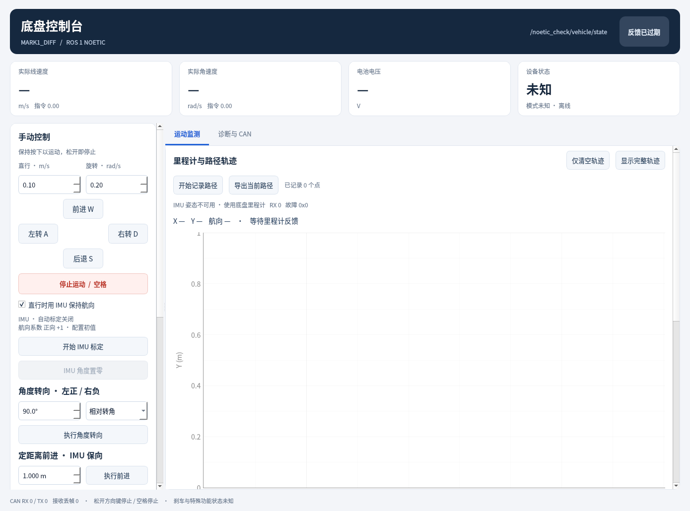

# Noetic 移植与 Orin 验证记录

以下是 2026-11-09 的历史记录，当时默认为只接收。2026-11-10 起默认改为允许实际控制，当前入口和操作步骤以 [README](../README.md) 为准；`tools/hardware_smoke.py` 继续显式使用只接收模式。

日期：2026-11-09。目标：`orin@172.18.2.136`，工作区 `/home/orin/vehicle_noetic_ws`。

## 软件验收

在 Orin 原机 Ubuntu 20.04.6 / ARM64 / ROS1 Noetic / GCC 9.4 / Python 3.8.10 上完成 catkin 开发空间和 install 空间构建。GUI 使用系统 PyQt5 5.14.1、PyQtGraph 0.11.0rc0。四个包、14 个消息、2 个自定义服务均生成成功；install 空间的可执行文件、动态库、Python 模块及 launch 均已检查。

最终测试 **95 项通过，0 失败、0 错误、0 跳过**：

| 范围 | 数量 | 原始证据 |
|---|---:|---|
| C++ 核心协议、传输、里程计、IMU、标定与运动控制 | 32 | [gtest XML](../artifacts/noetic_core_2026-11-09.xml) |
| ROS1 驱动/IMU、GUI 交互、模型、只接收保护与并发服务 | 63 | [pytest XML](../artifacts/noetic_pytest_2026-11-09.xml) |

可复核的机器汇总：[validation_2026-11-09.json](../artifacts/validation_2026-11-09.json)。

虚拟 CAN 测试在独立 `vcan_noetic` 上完成，包括：

- 原整车协议、设备身份过滤、异常帧、版本、四路驱动反馈、状态诊断。
- 发送成功、设备 ACK、实际状态确认的分别判断；服务超时和并发忙响应期间速度看门狗持续工作。
- 旧时间戳、NaN、失联、接口恢复、退出停止及显式失能不被自动改回。
- IMU CAN-FD、寻址 NMT Start、量纲换算、安装旋转、重复计数超时、设备重启、无效姿态与里程计回退。
- IMU 三轴软件置零、保留原样本时间、不跳变里程计、无效/过期数据拒绝置零。
- 正负 yaw 方向识别、双向旋转、超时、取消、人工接管及重标定。
- 相对转角、路径航向、定距、滑移前馈、目标续期、失效停止及到位判定。
- 完整的 24 项 Qt 控制台集成场景，包括按键/鼠标、失焦、界面冻结、服务反馈、路径维护、保向与自动运动。
- 默认 `receive_only` 的 stamped/unstamped 两种输入；即使显式请求初始化和标定，启动、速度/服务调用及退出全过程均没有底盘发送帧。

对照检查确认：全部消息和服务字段保留，只有 `State` 的 ROS2 `builtin_interfaces/Time` 改为 ROS1 原生 `time`；纯控制、协议、IMU 解码和里程计算法复用当前原工程源码。Classic CAN 的 `len` 字段改为旧版 Linux 兼容的 `can_dlc`。GUI 仅调整通信层、Python 3.8 注解兼容、ROS 版本标识及旧 PyQtGraph 图例 API。

## 物理接口与实机启动

本次没有让底盘运动。已将 Orin 的运行时网络接口配置为：

| 接口 | 配置 | 观测结果 |
|---|---|---|
| `can0` | 500000 bit/s，Classic CAN | 接口 UP、ERROR-ACTIVE；接收帧为 0、发送帧为 0 |
| `can1` | 1000000 / 4000000 bit/s，FD，两段采样点 0.8 | 接口 UP、ERROR-ACTIVE；未收到 IMU 心跳或 PDO |

先对两个接口分别进行 4 秒完全被动采样，然后通过独立 ROS master 启动只接收底盘节点、IMU 节点和 GUI。节点可正常启动、发布状态及诊断、接收服务请求并退出；GUI 自动截图与正常退出均成功。底盘从启动到退出的内核 `tx_packets` 增量为 **0**，最终物理 `can0` 的累计 `tx_packets=0`。

原始实机记录：[orin_hardware_2026-11-09.json](../artifacts/orin_hardware_2026-11-09.json)。

另使用 install 空间实际执行默认入口 `roslaunch vehicle_gui console.launch quit_after:=3`，底盘、IMU、GUI 均正常启动及关闭，默认只接收配置生效，`can0` 发送增量仍为 0：[默认启动检查](../artifacts/default_launch_check_2026-11-09.json)。



当前实机没有收到底盘或 IMU 报文，`vehicle_online=false`、`imu_online=false`、有效姿态样本数为 0。IMU 置零服务正确返回“没有新鲜有效姿态”，没有把缺测数据当作有效数据。**实物 IMU 数据链路、物理运动效果与运动精度尚未验收**；需要现场确认底盘/IMU 供电、接线、终端电阻及 IMU 实际接口。虚拟 IMU 测试通过不能替代这项实物验证。

系统只安装了缺少的 pytest/PyQtGraph 及其依赖。依赖安装使用临时 ARM64 Ubuntu Ports 源，未改写 Orin 原有 apt 软件源。没有创建底盘自动使能或开机自启动任务；测试创建的 ROS master、虚拟接口和测试节点均已退出。

## 后续只接收复测

现场连接可用后，在 Orin 上运行：

```bash
cd /home/orin/vehicle_noetic_ws
source /opt/ros/noetic/setup.bash
source devel/setup.bash
python3 tools/hardware_smoke.py --seconds 5 --output artifacts/hardware_recheck.json
```

该入口固定使用 `receive_only=true`，仅尝试 IMU 软件姿态置零。正常连接时应看到 IMU 在线、新鲜有效姿态和非零姿态频率；底盘发送增量仍应为 0。
